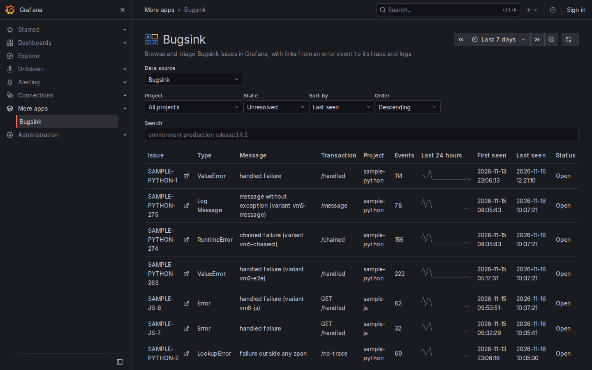
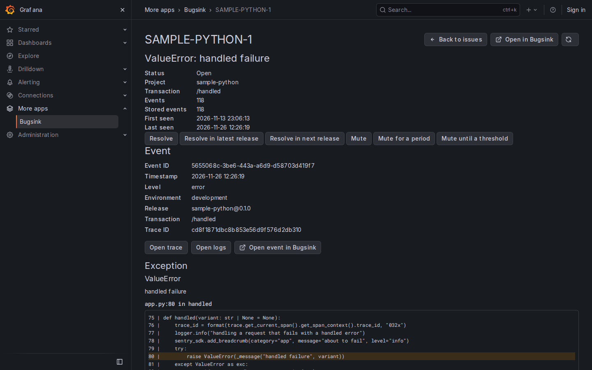

# Bugsink App Plugin for Grafana

View and triage [Bugsink](https://www.bugsink.com/) issues inside Grafana, and jump from an error event to its Tempo trace and Loki logs.

## Status

Version 0.1.1 is released on [GitHub Releases](https://github.com/a-h-i/grafana-bugsink-app/releases). Milestones M1 to M10 of the [implementation roadmap](design/implementation_roadmap.md) are built. M11 (a signed build in the Grafana plugin catalog) is under way: the plugin is submitted to the catalog and awaits approval, so the release build is unsigned for now. Changes per version are in [`CHANGELOG.md`](CHANGELOG.md); the design is in the [spec](design/bugsink_grafana_plugin_spec.md).

## Features

- **Data source**: connects to a Bugsink instance and checks the URL, the API token and its capabilities.
- **Dashboards and Explore**: query types for issues, events, event volume series, and alerting counts (issue count, event count, new issues).
- **Issue list page**: filter by project, state, search and time range, sort, with a 24-hour event chart per row; the state is kept in the URL.
- **Issue detail page**: summary, event detail with exception chain and stack trace, events, tags and history.
- **Trace and log links**: `Open trace` in Tempo and `Open logs` in Loki from an event's trace ID.
- **Triage**, off by default per data source: resolve, reopen, mute and unmute, resolve in a release, mute for a period or until a volume threshold, with an attribution comment in Bugsink naming the Grafana user.
- **Alerting**: Grafana alert rules on issue and event counts.





The user guide, with setup, the token capabilities and every setting, is [`src/README.md`](src/README.md).

## Install

Requires Grafana 13.2.0 or later. Download the zip from the [latest release](https://github.com/a-h-i/grafana-bugsink-app/releases/latest), unzip it into Grafana's plugin directory and allow both unsigned plugin ids:

```ini
[plugins]
allow_loading_unsigned_plugins = ahmedismail-bugsink-app,ahmedismail-bugsink-datasource
```

## Development

The local development stack runs Bugsink, Grafana, Tempo, Loki and a sample app; see [`docker/README.md`](docker/README.md).

Prerequisites: Node.js as in `.nvmrc`, Go as in `go.mod`, and Docker with Compose.

Build the frontend and the backend (Grafana mounts `dist/`):

```sh
npm ci
npm run build
npm run build:backend
```

Start the stack (Grafana on <http://localhost:3300>, Bugsink on <http://localhost:8800>) and check it:

```sh
docker compose up -d --wait
python3 scripts/verify_stack.py
```

See [`docker/README.md`](docker/README.md) for the stack's services, ports and seeded tokens.

Unit tests and checks:

```sh
npm run typecheck
npm run lint
npm run test:ci
go vet ./pkg/...
go test ./pkg/...
scripts/check_spdx.sh
scripts/check_licenses.sh
```

End-to-end tests run in a browser against the running stack. Install the browser once with `npx playwright install chromium`, then:

```sh
GRAFANA_URL=http://localhost:3300 npm run e2e
```

Regenerate the Bugsink API client in `pkg/bugsink/internal/gen/` from `bugsink-api/openapi.yaml`:

```sh
go generate ./pkg/bugsink/...
```

## License

Copyright (C) 2026 Ahmed Ismail

This program is free software: you can redistribute it and/or modify it under the terms of the GNU General Public License as published by the Free Software Foundation, either version 3 of the License, or (at your option) any later version.

This program is distributed in the hope that it will be useful, but WITHOUT ANY WARRANTY; without even the implied warranty of MERCHANTABILITY or FITNESS FOR A PARTICULAR PURPOSE. See [LICENSE](LICENSE) for details.

`bugsink-api/openapi.yaml` is Bugsink's OpenAPI schema under its own licence, not this one; see [`bugsink-api/NOTICE.md`](bugsink-api/NOTICE.md).
